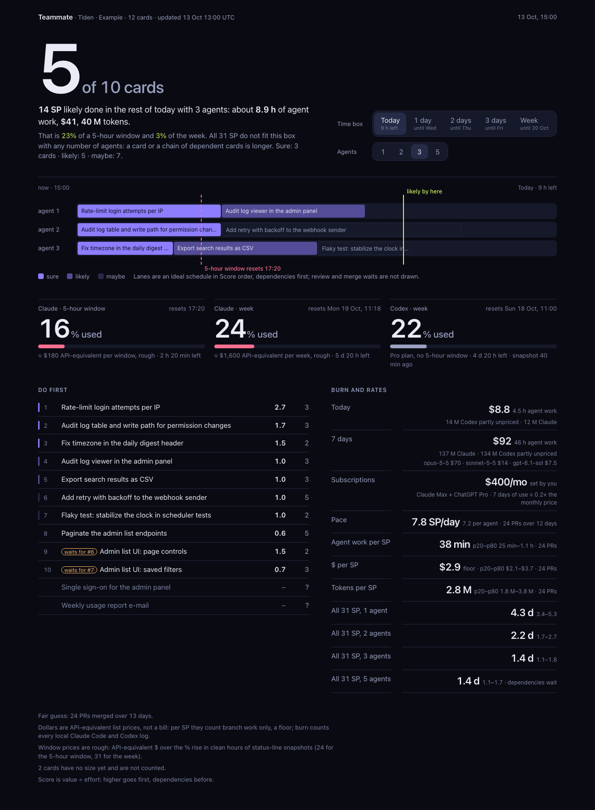

# agent-estimate

Your coding agent sizes each backlog item in story points and rates its value. `estimate` turns those
into hours, days and dollars using your own merged PRs, and orders the backlog by Score (value ÷ effort).
The agent never quotes time: agents guess their own runtime badly, but they rank task size reasonably well.

**Status: v0.** Accuracy is unproven until about 30 estimates logged before work have merged in your
repo; then run `estimate backtest` to see whether the forecast beats a simple baseline. Everything runs
locally: see Privacy.



*The dashboard, built from synthetic data (`tests/ui/fixtures.py`).*

## Quickstart

Needs Python 3.11+ and the [`gh`](https://cli.github.com) CLI, logged in (`gh auth login`). No other dependencies.

```sh
git clone https://github.com/egerev/agent-estimate && python3 agent-estimate/estimate.py install   # `estimate` on PATH + agent skills
cd your-project && estimate setup                                                               # where is your backlog?
estimate dashboard                                                                              # .estimate/dashboard.html
```

Then ask your agent: **"estimate the backlog"**. It uses the `estimate-backlog` skill: sets effort, value
and dependencies for every item and writes them back. Run `estimate dashboard` again and open the file in
a browser. In a repo with merged PRs, `estimate init --last 30` gives the planner a pace on day one (see Use).

The dashboard answers one question first: pick a time box (the rest of today, 1, 2 or 3 days, a week)
and 1, 2, 3 or 5 agents, and it shows how many cards likely get done, with sure and maybe waterlines,
their agent hours, $ and tokens, and about how many agents all of the backlog would need in that box. Agent
lanes draw the schedule (cards never split, dependencies first); the backlog follows by Score (top 12, then all), each row marked sure, likely or
maybe. Burn and rates: tokens, API-equivalent $ and agent hours today and over 7 days from your local
Claude Code and Codex logs (every repo; `--no-burn` skips them), SP per day, agent work, $ and tokens per
SP with their sample sizes, and days for the whole backlog. The source line names where the cards came from, e.g.
`Tiden · Shop · 52 cards · updated 22 Oct 07:29 UTC`. Cards without a size are listed at the end and
left out of the totals. Details stay in the CLI (`forecast --backlog`, `calibrate`, `backtest`).

The **Usage** section (30 or 90 days, also `estimate usage [--days 7|30|90] [--json]`) reads the same local
logs for every repo: $ and tokens per repo (each session's folder maps to its git remote, so worktrees pool),
the top 10 sessions by $ with a short label (the first line of the first prompt, cut to 60 characters;
`--no-labels` or `"session_labels": false` in `config.json` hides it), cache tiles (processed tokens, cached
input share, uncached input, output, and what cached reads saved at the input price), daily $ by agent and
by model, how many sessions you run at once (median and p80 over active 15-minute slots, shown next to the
planner's agent count as "you usually run ~N"), merged PRs per session, and a model table where a model
without a price is marked approximate. A folder with no git
repo is listed as `~/<top folder> (folder)`.

### Plan windows and subscriptions

The window cards show how much of the Claude 5-hour and weekly windows and the Codex week is used, with
reset times. Codex numbers come from its session logs. Claude's come from the status line, which you opt
into once:

```sh
estimate install --statusline   # wraps your Claude Code status line; it keeps running as before
```

Each status line refresh then logs only the two % values, their reset times and a short one-way tag of
the signed-in account to `~/.local/state/agent-estimate/windows.jsonl` (`$ESTIMATE_WINDOWS_FILE`). A
`~/.claude/data/rate_history.jsonl` from your own status line is read too (% only, no reset times).
`estimate uninstall` restores your status line. Without snapshots a card says "no snapshot yet"; a
window whose reset has passed is never shown as current. With at least 10 clean hours of snapshots
(one account, no reset), the cards add a rough API-equivalent $ per window, and the planner says how
much of the 5-hour and weekly windows a box would take; the Today lanes mark the 5-hour reset.

Type your plans once into `.estimate/config.json` to see what they cost against your API-equivalent use:

```json
{"subscriptions": [{"name": "Claude Max", "usd_per_month": 200}, {"name": "ChatGPT Pro", "usd_per_month": 200}]}
```

The first numbers are rough. With merged PRs in the repo, `estimate init --last 30` seeds the history by
blind retro-sizing (see Use). Without history, every estimate you log is measured when its PR merges,
and ranges sharpen as PRs accumulate.

## Backlog sources

- **Markdown** (default): a table with `id | title | effort | value | depends`, e.g. `BACKLOG.md`.
  See `examples/backlog.example.md`.
- **Tiden**: `estimate backlog pull` copies open cards into `.estimate/backlog.md`. Read-only; nothing is
  written back to Tiden.
- **Linear**: planned, not built yet.

## Privacy

Nothing leaves your machine: no telemetry. The network calls are `gh` to your own GitHub (merged PRs,
their commits and file lists) and, only if you use it, `estimate backlog pull`, which reads your cards
read-only through the `tiden` CLI. The tool reads, locally and read-only, your Claude Code
transcripts (`~/.claude/projects`) and Codex session logs (`~/.codex/sessions`), keeping only token
counts, timestamps, model names and branch names. With the opt-in `estimate install --statusline`, the
Claude Code status-line JSON adds window % and reset times to `~/.local/state/agent-estimate/windows.jsonl`
(plus an 8-character account hash, never the e-mail or session). Its data stay in `.estimate/` in your repo, which
ignores itself in Git. The dashboard is one static HTML file with no scripts and no network requests:
card titles, sizes, hours, $ and token counts, never prompts, outputs or file contents. Details in
the Privacy reference below.

## What is measured

For every merged PR, with no manual entry: wall hours, observed active hours, API-equivalent dollars,
review rounds, and which agent and model did the work. Ranges per story point come from the last
14 days of merged PRs (p20–p80), and each quote shows its sample size and a confidence level.
Field definitions are in Measurement details below.

## Honest limits

- **Accuracy is unproven.** The ranges describe recent history; they are not validated predictions.
  Log about 30 estimates before work, let them merge, then run `estimate backtest`. It compares the
  forecast with a simple baseline ("median of the last 10 PRs"). If the forecast does not beat the
  baseline, the story-point step adds nothing for your repo.
- **Calendar days with several agents are an optimistic bound.** Concurrency is measured from PR
  overlap, which includes waiting time, not only simultaneous work.
- **$ is API-equivalent, not a bill, and covers PR-branch work only.** Planning, reviews outside the
  branch, orchestration and work on `main` are not counted. Read it as a floor.
- Observed activity is a heuristic from log gaps. More limits are listed at the end of the reference.

---

# Reference

## Install details

```sh
git clone https://github.com/egerev/agent-estimate ~/Projects/agent-estimate
cd ~/Projects/agent-estimate && python3 estimate.py install   # `estimate` on PATH + skills in Claude Code, Codex, .agents
gh auth login                                                 # once; install reports if gh is not logged in
cd your-project && estimate setup                             # where is your backlog: Markdown file or Tiden
```

`install` symlinks `estimate` into `~/.local/bin` (`--bin-dir`) and each `skills/*` into every of
`~/.claude/skills`, `~/.codex/skills`, `~/.agents/skills` that exists. It is idempotent, skips anything it
did not create, and `--dry-run` previews. `estimate uninstall` removes only links into this repo. `setup` writes `.estimate/config.json`
(`--source markdown|tiden`, `--path`, `--product-id` skip the questions).

**Data kept outside the repo.** Environment variables set the defaults, so no alias or wrapper is needed;
flags still win:

```sh
export ESTIMATE_DIR=~/estimates/shop          # --dir: the data directory
export ESTIMATE_REPO=acme/shop                # --repo: owner/name, when not run inside the checkout
export ESTIMATE_CLAUDE_PROJECT_DIR=~/.claude/projects/-work-shop   # --claude-project-dir; several joined with ':'
```

For several projects in one shell, use a function rather than an alias in a string variable:
`shop() { ESTIMATE_DIR=~/estimates/shop ESTIMATE_REPO=acme/shop estimate "$@"; }`.

### Running from worktrees and many agents

Each worktree is its own checkout, so `<git root>/.estimate` differs per worktree, and an agent started
in one sees an empty data dir. Link the data dir to the repo once instead:

```sh
estimate link --dir ~/estimates/shop [--claude-project-dir ~/.claude/projects/-work-shop]
```

This writes `~/.config/agent-estimate/projects.json` (`$ESTIMATE_REGISTRY`), keyed by the git remote
(`owner/repo`), so every worktree, branch and agent of the repo resolves the same dir, repo and trusted
Claude transcript dirs. `estimate setup` writes the same entry. Without `--dir` or `$ESTIMATE_DIR`,
`estimate` looks for, in order: the nearest `.estimate/` above the current directory that holds a
ledger, history or config; the registry entry for the git remote; `<git root>/.estimate`.

`estimate doctor` prints what it resolved and from where, the ledger and history counts, calibration n,
`gh` auth and the status-line hook. On an empty data dir, `forecast` and `dashboard` stop with one
message naming the dir instead of printing n=0 numbers. Many agents can log estimates at once: the
ledger is append-only.

## Use

In a new repo with no history, just start: every `estimate forecast --task ...` is logged and gets
measured when its PR merges.

In a repo with history, `init` gives a rough base by **blind retro-sizing**:

```sh
estimate init --last 30            # writes .estimate/retro-packet.md: 30 recent merged PRs, no dates
# the agent sizes them from title, body and file list, without looking up durations, and writes
# .estimate/retro-sizes.json as {"123": 3, ...}
estimate init --apply .estimate/retro-sizes.json --agent claude-code --model claude-opus-5-5
```

Several agents or models can size the same packet (one `--apply` each); `calibrate` then compares
them on identical tasks. Overall numbers count each PR once.

The packet uses the same points as the backlog and `forecast --sp`, plus 13: a merged PR cannot be
split, so 13 there means "more than 8, would have been split". PRs whose line counts may overstate
the work (50+ files, mostly lockfiles, snapshots, drafts or generated files, or such words in the
title) are marked **Mechanical?**.

Day to day:

```sh
estimate forecast --sp 3 --task 142 --model claude-opus-5-5   # one line; logs the estimate
estimate forecast --sp 3 --closest 120 --task my-branch ...   # optional: the closest past PR
estimate forecast --backlog backlog.md                        # totals + Score order (see Backlog)
estimate forecast --backlog                                   # the backlog named in .estimate/config.json
estimate plan [--agents 3] [--top N] [--json]                 # critical-chain plan: dates per agent count (see Plan)
estimate backlog pull                                         # Tiden source: open cards -> .estimate/backlog.md
estimate record                                               # settle merged PRs (automatic actuals)
estimate record --refresh                                     # remeasure tracked PRs after log/price changes
estimate record --all                                         # every project in ~/.config/agent-estimate/projects.json, one line each
estimate dashboard --all                                      # the same loop for dashboards
estimate calibrate                                            # ranges per SP and per estimator
estimate dashboard                                            # .estimate/dashboard.html
estimate usage [--days 7|30|90] [--json] [--no-labels]        # spend by repo, cache, trend, parallel sessions, models
estimate backtest                                             # leave-future-out accuracy
estimate compare --dir ../app-a/.estimate --dir ../app-b/.estimate   # process traits per project
```

`--all` (for a nightly job) prints one line per project (`settled`, `new PRs`, `calibration n`, `pre-work
n`), goes on after a project fails, and exits non-zero only when every project failed. A branch estimate
whose branch has no PR (open or merged) after 7 days is marked `no PR` by `record` (`--no-pr-days N`, 0 never):
it stays in the ledger, leaves the pending list, is listed by `estimate doctor`, and a PR merged later
still settles it.

A PR body line `SP: 3` is also picked up by `record` (estimator and original sizing time unknown).
It is timestamped when first observed, never backdated to PR creation. It is excluded as a
prospective backtest target; it can inform later forecasts once it was actually observed.

Global flags: `--repo owner/name` (default: the current repo), `--dir` (data directory, default
`<git root>/.estimate`), `--window 14` (days), `--idle-min 5`, `--claude-dir`, `--codex-dir`,
`--claude-project-dir PATH` (repeatable, explicitly trusts a transcript directory under `~/.claude/projects` for
this repo; a checkout path is mapped to its transcript directory there, anything else gets a warning in `link`
and `doctor`. Usually omit it: matching by repo and branch is the default).
`--claude-all` remains accepted for compatibility; scanning now checks identity in every directory.

## Backlog

A backlog is a Markdown table (extra columns, prose and other tables are ignored; write `\|` for a pipe in a title):

```markdown
| id | title | effort | value | depends |
|----|-------|--------|-------|---------|
| 1 | Audit log table and write path | 3 | 5 | |
| 2 | Audit log viewer in the admin panel | 3 | 3 | 1 |
```

Effort is Fibonacci SP (1, 2, 3, 5, 8; 13 must be split), value is 1, 2, 3, 5 or 8, depends lists
ids that must come first. `estimate forecast --backlog FILE` adds Score = value / effort and orders
by Score, never placing an item before its dependencies; an item pushed down shows `waits for #n`,
and an item placed before higher-Score work that needs it shows `unblocks #n`. A UUID id is shown
by its first 8 characters when no other id shares them (or by the `key` column, e.g. KEY-21); an id you
wrote yourself (`1`, `BL-3`) is always shown as written, its key next to the title. `depends` accepts
the full id, the key or that prefix; the full id stays in the file.
Unknown ids and cycles are warnings; the affected items follow the ranked ones in file order. The tool honors only written
dependencies and infers none. A row without effort stops the forecast; `--skip-unsized` leaves such
rows out of the totals and the order instead and names them in a warning (an item that depends on one
is kept in file order). The old `<SP> <title>` line format still works; those items have no
Score and come after scored ones. See `examples/backlog.example.md`.

The totals separate work from elapsed time. **Agent active time, summed** is one agent working
serially, not wall clock. **Wall clock** lines give calendar days for 1, 2, 3 and 5 agents in parallel
(p20–p80), never shorter than the longest dependency chain; for 2+ agents they assume perfect hand-offs,
so read them as a lower bound. One `calibration n=…` line counts PRs left out of the sample (outside the
window, no agent logs, pending estimates); `estimate doctor` and `estimate record` list them.

**Where the backlog lives.** `.estimate/config.json` names the source; `estimate forecast --backlog`
without FILE uses it:

```json
{"backlog": {"source": "markdown", "path": "BACKLOG.md"}}
{"backlog": {"source": "tiden", "product_id": "<id; omit when the repo is linked with tiden setup; required with --dir or $ESTIMATE_DIR>",
             "statuses": ["Backlog", "Review"]}}
```

No config means Markdown, `BACKLOG.md` at the git root (a relative `path` is resolved from there).
For Tiden, `estimate backlog pull` runs `tiden spec list --format json --include-sources` and writes the open cards to
`.estimate/backlog.md`: status Backlog or Review (set `statuses` to pull fewer or others), minus containers
(cards with child cards: the children are the work, so their size is never counted twice; the pull names them).
An open card that Tiden links to a pull request or code anchors gets the note `maybe-done` (Tiden statuses lag
merges): it stays in the totals, and `forecast` and the dashboard name it until it is closed in Tiden. It also reads the product's name (`tiden product list`) for the dashboard. Id is the Tiden id; `key` is a
human key such as KEY-21 when the card has one. Effort and Value are taken from `Effort: N` / `Value: N` in the card text when on the scale,
and Depends from other open cards named on a `Depends on` line (a Tiden id; a key such as KEY-44; or the product
code with the card's number, e.g. ACME-225, up to the end of that sentence). Priority is copied as a column
and never turned into Value. A re-pull keeps effort, value and depends set locally for the same id (an empty
depends cell takes the card's `Depends on` line; write `-` for none), keeps a `lane` column and any sections
after the table, and drops cards no longer open, with a note. Rows you add by hand with your own id (not a Tiden UUID, e.g. `1`) are never
dropped: a re-pull keeps them as they are, after the cards. The pull is read-only: nothing is written back to Tiden.

## Plan

`estimate plan` forecasts when the backlog gets done with 1, 2, 3 and 5 agents (and `--agents K`). It runs a
list scheduler 500 times (seeded): a free agent takes the next card whose dependencies are merged, in Score
order, except that a card on the critical chain goes first once delaying it would delay the end. Card time is
SP × a work rate per SP drawn from the window's merged PRs (the two-level bootstrap of `forecast`), scaled to
this repo's calendar pace (calendar hours per hour with a PR in flight), then that PR's merge wait (last commit
to merge). The agent moves on during the merge wait; dependent cards wait for the merge.

It prints p50/p80 finish dates per agent count with what one more agent saves, the max useful agent count
(the next one saves under 5%), the project buffer (p80 − p50 at the end; no padding per card), the critical
chain (the longest dependency chain at median card times), waves (cards in start order; a new wave starts at a
card that needs one of the current wave) with p50/p80 dates, and the most waited-on cards. `--json` adds p20,
p50 and p80 for every card. Unsized cards are skipped with a warning; cards with unknown or unsized
dependencies, or in a cycle, are excluded and named. With no dependencies at all, it says the order is Score
only; under 5 measured PRs the dates are marked rough.

**Lanes** limit parallel work on shared files: an optional `lane` column, with caps in a `## Lanes` section
below the table (`- migration (cap 1): …`, `- bot.py (merging cap 1)`) or in `.estimate/config.json`, which
wins per lane: `{"lanes": {"bot.py": {"open": 1}, "migration": {"merging": 1}}}`. `open` caps the lane's cards
started and not merged; `merging` caps those in their merge wait. Cards without a lane run in parallel.

The dashboard's **Ahead** section draws the next 20 cards in agent lanes for the selected agent count: the
critical chain in the accent colour, cards that wait for another one dimmed, the merge wait hatched, the p50
marker and the buffer to p80. The lanes show the simulated run that ends nearest the p50.

## Measurement details

Per merged PR, automatically, never by hand:

| Field | Meaning |
|---|---|
| `wall_h` | earliest available logged task estimate, PR creation, commit or attributed agent record → merge; `start_source` identifies the signal. Agent records at most 10 min before the estimate, with no commit or PR before it, are the sizing itself and do not move the start |
| `active_h` | approximate observed activity: intervals between records at most 5 min apart within each stream; parallel intervals are unioned |
| `wait_h` | unknown (`null`): log gaps do not establish review, CI or owner waits |
| `unobserved_h` | `wall_h − active_h`; may include real work without nearby log records |
| `usd` | API-equivalent cost of observed token usage, only when every observed response has known usage and model pricing |
| `known_usd` | priced subtotal; incomplete totals remain visible here and are excluded from dollar forecasts |
| `cost_complete` | completeness within observed logs, not proof that all project work was logged; `unpriced_msgs` and `missing_usage_msgs` explain gaps |
| `usage_by_model` | normalized usage per request, retained to audit rates and context tiers |
| `executor` | the agent/model with the most active hours in main sessions on the branch; `agents` keeps the full split |
| `review_rounds` | GitHub reviews on the PR that approved or requested changes (reviews done outside GitHub, such as agent reviewers, are not seen) |

A log record belongs to a PR when its git branch is the PR's head branch inside the PR's window,
or when its Claude Code session links exactly that one PR. Claude sessions require an exact repository
PR link, a `cwd` whose git remote matches `owner/name`, or an explicitly trusted
`--claude-project-dir`. A session whose `cwd` no longer exists (a worktree removed after merge) is accepted
when a session of the same transcript directory in that `cwd` was identified. A similar directory name is insufficient. Codex sessions require this repo's
git remote. Parent and subagent files keep separate activity streams, even with a shared session ID.
Repeated Claude usage snapshots use the final response usage; file discovery order does not affect cost.
Attribution includes observed branch work before the first commit or PR creation, without a seven-day
age limit; successive known PRs that reuse a branch are split at the previous merge. Missing older
PR history can make reuse ambiguous, so keep sufficient `--history` when measuring reused branches.

Calibration uses a recent window (default 14 days), rebuilt for every forecast using the current date,
window and saved process cutoff. Overall calibration counts each PR once, preferring its earliest
non-retro estimate; per-estimator views also count each PR once. A Fibonacci bucket with at least 5 settled PRs
uses its own p20–p80; otherwise the per-SP rate (hours ÷ SP) of the whole window is scaled by SP.
The interval is then widened, never narrowed, to the p20–p80 of the leave-one-out forecast error in the
window (each PR against the median rate of the others), because the p20–p80 of a few past rates holds
fewer than 60% of new tasks; the p50 stays.
Each metric shows its own eligible PR count, interval kind and confidence.
Fewer than 5 PRs give a min–max range and low confidence. Overall confidence uses the weakest available
time/cost metric; a large wall-time sample does not raise confidence in sparse cost data. Confidence
comes from n, interval width and calibration age, never from the model. A drift flag fires when a
median per-SP rate moved more than 2× against the previous window.

The backlog forecast uses total SP × observed min–max rates below five independent PRs per metric.
Larger samples use a two-level bootstrap: each simulation resamples the n historical per-SP rates, then
draws every item's rate from that resample. Independent draws from one fixed history let item scatter
cancel out over a long backlog and claim more precision than n PRs support; summing per-item p20/p80
assumes every item is slow at once. The total's confidence comes from the per-item rate spread, not from
the (narrow) spread of the sum. Calendar days resample days of the window, each with its SP and its share
of the day (edge days are partial), so they reproduce the window's SP/day. `forecast --backlog` says
what the days are based on, and warn when observed agent hours fill under 10% of the
calendar time: then waits (reviews, merges, idle days), not work, set the date. Sizes must be positive
Fibonacci values; 13 SP items retain a split warning.

**Why n is what it is.** `init --apply`, `calibrate`, `forecast` (on stderr for `--sp`, so the quote stays one
line) list the sized PRs left out of calibration per reason (merged before
the window or the saved `--since`, pending estimates, extra estimates of the same PR), and the PRs without
observed hours or a complete $ total per reason (no agent logs on the branch, no price for a named model,
responses without token usage, cost from an older version). When `record` settles nothing, it says how many
merged PRs and pending estimates it checked and why each pending estimate did not settle.

`record --refresh` appends replacement actual events for all settled estimates, including PRs outside
the recent `--history` page, and preserves their original estimates and timestamps. Use it after importing
logs or changing prices. Existing ledger costs without an explicit `cost_complete: true` are excluded
until refreshed. The operation reads local logs and GitHub; it does not rewrite old ledger events.

## Learning loop

Agents give only SP. The tool turns SP into time and $ from merged-PR history and says how much to trust it.

**Per-estimator ranges.** Once an estimator (agent/model) has 5 settled estimates logged before work
in the window, its forecasts use its own hours and $ per SP. Until then they use all estimators pooled.
Retro sizes and estimates logged after work started count toward the estimator's table, not toward the
5. Every quote says which ranges it used and the sample size, e.g. `own ranges of codex/gpt-5, 7 pre-work PRs`
or `pooled: all estimators; codex/gpt-5 has 2/5 pre-work PRs`. `calibrate` shows the same
pre-work count per estimator.

**Accuracy.** `estimate backtest` reports, per metric: PRs scored, the share of actuals
inside p20–p80 (about 60% is calibrated), the median error |p50 − actual| / actual, and the same error for
the "median of the last 10 PRs" baseline. The forecast-vs-baseline verdict uses only PRs that have both
errors (paired) and needs 10 pairs; below 10 scored or paired PRs it says "not enough data".

**Compare projects.** `estimate compare --dir A --dir B [...]` takes one `.estimate` directory per project
and prints one table per project: PRs, median observed active h/SP, wall h/SP, wait share
((wall − active) / wall, i.e. unobserved time, not proven waits), $/SP, review rounds and executor mix.
All settled PRs count, each once. A project is labelled by the repo in its retro packet, else by the
directory name. `--json` gives the same numbers for scripts.

## Privacy

- Data stay in `.estimate/` (it ignores itself via its own `.gitignore`) or `--dir`. Nothing is sent
  anywhere: the network calls are `gh` to your own GitHub and, for `backlog pull` only, the `tiden` CLI
  (read-only). No telemetry.
- PR titles, bodies and file lists go into the retro packet, read by your own agent session, which
  already has the repo.
- The dashboard is one HTML file without scripts and with a Content-Security-Policy that blocks all
  requests. Building it needs no network. Its burn rows read the last 7 days of `~/.claude/projects`
  and `~/.codex/sessions` (every repo, `--claude-dir`/`--codex-dir` to change, `--no-burn` to skip);
  only token counts, timestamps and model names are kept, and the page shows counts, $ and model
  names, never prompts, outputs or file contents. The Usage section and `estimate usage` read 30 or 90
  days and also keep each session's working directory (to find its repo through `git remote`) and, unless
  `--no-labels` or `"session_labels": false`, the first line of its first prompt cut to 60 characters with
  key-like strings masked; nothing more of any prompt is kept or written.
- `estimate install --statusline` is opt-in and changes one key, `statusLine` in your Claude Code
  `settings.json` (a copy is kept as `settings.json.estimate-backup`). Its snapshots hold window %, reset
  times and an 8-character hash of the account id, never the e-mail, the session or the working
  directory. Codex window numbers are read from its logs; its credit balance is not kept.
- Prices: `DEFAULT_PRICES` uses version-specific standard Claude API rates, checked against
  [Anthropic's pricing documentation](https://platform.claude.com/docs/en/about-claude/pricing)
  on 2026-10-20, including 5-minute/1-hour cache writes and Haiku 5.5's per-request context tier.
  The Codex models seen in our logs (`gpt-6-astra`, `gpt-6-sol`, `gpt-6.1-sol`) use OpenAI's standard list prices as of
  2026-10-26 ([pricing](https://developers.openai.com/api/docs/pricing)), including the long-context tier
  above 272K input tokens and 30-minute/12-hour cache writes (1.25×/2.5× input). A Codex response logged without token usage keeps that PR's $ unknown, and
  the audit line says so.
  API-equivalent cost is not an actual subscription bill. Provider, fast-mode and other billing
  modifiers are not inferred. Known model IDs accept dated suffixes; unknown future versions remain
  unpriced. Put a complete replacement table in `.estimate/prices.json` for your own rates; explicit
  custom family keys still match model substrings. Each row has `input`, `output`, `cache_read`,
  `cache_write_5m`, `cache_write_1h` in dollars per million tokens. Missing models retain token usage
  and priced subtotals, while their full dollar total stays unknown.

## Limits

- **Accuracy unproven until measured.** See Honest limits above.
- Retro-sized rows are sized after the fact; the sizer sees the final diff, which a real estimate
  does not. They can train later forecasts after they were logged, but are never prospective backtest
  targets. `backtest --include-retro` puts their hypothetical historical results in a separate diagnostic.
  Prospective targets must have been logged by the measured work start; every target PR is excluded
  from its own training, and the baseline uses the last ten distinct PRs. Saved `--since` applies here too.
- **$ and agent hours are PR-branch work only**: they exclude orchestration, planning and reviews
  outside the branch (card writing, work on `main`, coordinator sessions). In one multi-agent repo,
  a full-cost study came to about $6–10 per SP while the branch-only figure here was about $3.
  Read the dashboard's $ as a floor, not the full cost.
- A Claude Code session that switches branches is attributed per record by its branch. Codex records
  the branch once per session, so a Codex session that switches branches stays on its first one. A
  reused branch name is split by PR windows.
- An estimate logged by branch name settles with the first PR on that branch merged after it.
- Observed activity is a log-gap heuristic, not measured execution or human effort. Long-running tools
  with sparse logs can be undercounted; wall time includes both work and waits without distinguishing them.
- Process changes shift every constant. Run `calibrate --since <date>` after a change; it is saved in `.estimate/config.json` until `--since none`.
- Story points invite inflation once they drive metrics. Retro sizing is blind to durations for
  this reason; keep estimates logged before work.
- The bootstrap draws items independently given the resampled history, so a shared slowdown beyond
  what the history shows (a new area, another agent) is not covered.
- `gh` limits: the merged-PR query reads up to 100 files and 100 commits per PR. Missing older commits
  or logs can make the reported start later than the real start; repository identity checks can omit
  sessions whose old checkout no longer exists unless explicitly trusted.

## Tests

```sh
python3 -m unittest discover -s tests
uv run --with playwright python tests/ui/check_dashboard.py   # optional browser check of the dashboard
```

## License

MIT. See LICENSE.
